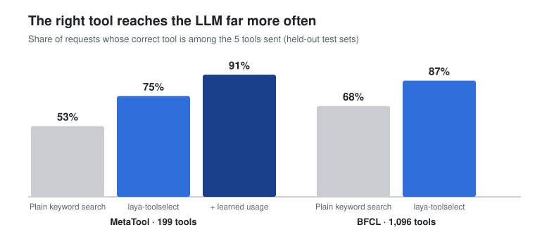
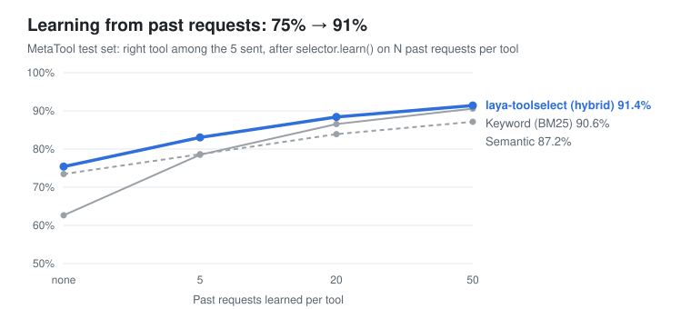
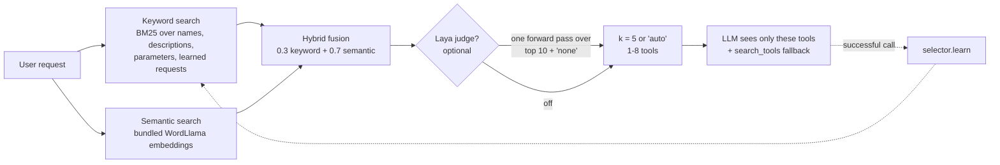

# laya-toolselect

**Give your LLM agent hundreds of tools without drowning it.** For each request, laya-toolselect
picks the handful of tools that matter, in under 1 ms, on a laptop CPU, with no API calls, and
hands them back in the format you already use (OpenAI, Claude, MCP or LangChain).

[](https://github.com/surajmhaske02/laya-toolselect/actions/workflows/tests.yml)


```python
from laya_toolselect import ToolSelector

selector = ToolSelector(all_my_tools)                        # 10 or 10,000 tools, any format
picked = selector.select("book a table for two tonight", k="auto")
client.chat.completions.create(model=..., messages=..., tools=picked.tools)   # just the few that matter
```

## The problem

Agents get worse as you add tools. Every tool's name, description and JSON schema goes into
the prompt on every call. With a big catalog, that costs tokens and confuses the model.

- In the [RAG-MCP study](https://arxiv.org/html/2505.03275v1), an LLM shown every tool picked the
  right one **13.6%** of the time. When a retriever chose the tools first, that rose to **43.1%**,
  with about half the prompt tokens.
- The 1,096 functions of the Berkeley Function Calling Leaderboard add up to **~168,000 tokens** of
  tool definitions, more than many models' entire context window.

## What you get

<p align="center"></p>

| Benefit | Measured on held-out test sets |
|---|---|
| **More of the right tools reach the LLM** | Right tool among the 5 sent: **75%** vs 53% for plain keyword search (MetaTool, 199 tools); **87%** vs 68% (BFCL, 1,096 tools) |
| **Far smaller prompts** | BFCL catalog ≈ 168,000 tokens → **≈ 865 tokens** per request with `k="auto"` (~99.5% less tool text) |
| **Gets better with use** | `selector.learn(request, tool)` after successful calls: 75% → **91%** with 50 past requests per tool |
| **Practically free** | 0.4–0.7 ms per request on one CPU thread; indexing 1,096 tools takes 0.3 s |
| **No infrastructure** | No vector database, GPU, API key or network call. The semantic model (16 MB) ships inside the pip package |
| **Drop-in** | Accepts and returns OpenAI, Anthropic, MCP (`list_tools()` result), LangChain and plain Python functions |
| **Safe fallback** | A built-in `search_tools` meta-tool lets the LLM find any tool the selection missed |
| **Private** | Everything runs locally; tool definitions and user requests never leave your process |

<p align="center"></p>

## Install

```bash
pip install "laya-toolselect[semantic]"   # recommended: keyword + bundled semantic model
pip install laya-toolselect               # keyword only, numpy is the only dependency
pip install "laya-toolselect[all]"        # + the optional Laya judge (PyTorch)
```

Not on PyPI yet? Install from this repo:
`pip install "laya-toolselect[semantic] @ git+https://github.com/surajmhaske02/laya-toolselect"`

## How it works



1. **Keyword search** splits names like `getWeatherForecast` into words. It indexes descriptions, parameters and learned example requests.
2. **Semantic search** catches paraphrases ("will it rain?" → `get_weather`) using offline embeddings.
3. **Hybrid fusion** combines both. It is the best or tied-best option on both benchmarks.
4. **Optional [Laya](https://github.com/NandhaKishorM/laya) judge.** A small local model re-scores the top 10 in one forward pass. It also reports `p_none`, the probability that no tool fits, in 100+ languages.
5. **`k="auto"`** sends fewer tools for clear requests and more for ambiguous ones.

## Use it with your stack

<details open><summary><b>OpenAI function calling, with the search_tools fallback</b></summary>

```python
picked = selector.select(user_message, k="auto")
tools = picked.tools + [selector.search_tool("openai")]
resp = client.chat.completions.create(model="gpt-4.1-mini", messages=messages, tools=tools)
for call in resp.choices[0].message.tool_calls or []:
    if call.function.name == "search_tools":                 # the model asks for more tools
        tools += selector.handle_search(call.function.arguments, fmt="openai")
    else:
        run_tool(call)
        selector.learn(user_message, call.function.name)       # gets better with use
```
</details>

<details><summary><b>Claude + MCP servers</b></summary>

```python
listed = await session.list_tools()          # any MCP server
selector = ToolSelector(listed)
picked = selector.select(request, k="auto")
msg = anthropic.messages.create(model="claude-sonnet-5-5", max_tokens=1024,
                                tools=picked.as_anthropic(),      # inputSchema -> input_schema
                                messages=[{"role": "user", "content": request}])
```
</details>

<details><summary><b>Laya judge with "no tool needed" detection</b></summary>

```python
from laya_toolselect import LayaJudge, ToolSelector
selector = ToolSelector(tools, judge=LayaJudge("multilingual"))
res = selector.select("Tell me a joke", k="auto")
if res.p_none > 0.6:      # placeholder threshold: calibrate on your traffic
    ...                   # answer without tools
```
</details>

<details><summary><b>Command line</b></summary>

```bash
laya-toolselect select tools.json "dinner reservation for two" -k auto --explain
laya-toolselect select tools.json "weather in Pune" -k 3 --format anthropic
```
</details>

Runnable examples: [`examples/`](examples). Full API: [`docs/REFERENCE.md`](docs/REFERENCE.md).

## Benchmarks

Data: [MetaTool](https://github.com/HowieHwong/MetaTool) (199 real ChatGPT plugins, 20,614 labeled
requests) and [BFCL v4](https://github.com/ShishirPatil/gorilla/tree/main/berkeley-function-call-leaderboard)
(1,096 functions pooled into one catalog). Settings were chosen on dev splits, and the test splits
were run once.

| Dataset | Method | Top 1 | Top 5 | Top 10 | `k="auto"`: tools sent / right tool included |
|---|---|---:|---:|---:|---:|
| MetaTool | Plain keyword search (descriptions) | 35.9% | 52.9% | 58.7% | 3.1 / 47.8% |
| MetaTool | **laya-toolselect** | **51.4%** | **75.4%** | **82.5%** | 4.0 / 75.0% |
| MetaTool | **laya-toolselect + learned usage (50/tool)** | **73.0%** | **91.4%** | **94.8%** | 3.4 / 91.8% |
| BFCL | Plain keyword search (descriptions) | 46.4% | 68.0% | 75.0% | 3.3 / 64.5% |
| BFCL | **laya-toolselect** | **65.2%** | **87.0%** | **94.8%** | 5.2 / 91.9% |

Gains over plain keyword search on top-5 recall, with paired bootstrap 95% intervals: +22.5 points
[+20.4, +24.4] on MetaTool and +19.0 [+16.6, +21.4] on BFCL. More detail in
[`benchmarks/REPORT.md`](benchmarks/REPORT.md).

```bash
bash benchmarks/fetch_data.sh && python benchmarks/run.py --split test   # reproduce
```

## Honest limits

- These are retrieval numbers: they measure whether the right tool reaches the LLM, not
  end-to-end task success.
- The optional Laya judge has been checked against Laya's own validator but **not yet measured**
  for accuracy or speed. Run `benchmarks/run_laya.py` on a machine with Hugging Face access.
- The defaults are tuned for English. For other languages, pass a multilingual embedder and use the
  multilingual Laya judge.
- Retrieval can miss: at k=5, about 1 request in 4 on MetaTool and 1 in 8 on BFCL. Keep the
  `search_tools` fallback and use `learn()`.

## Roadmap

- Measure the Laya judge and calibrate `p_none`
- An MCP gateway server that fronts many MCP servers and exposes only the relevant tools
- Requests that need several tools at once
- Fine-tuned Laya checkpoint for tool selection

## Development

```bash
pip install -e ".[dev]"
pytest              # 29 tests
```

Apache-2.0. Built on [Laya](https://github.com/NandhaKishorM/laya) (optional) and
[WordLlama](https://github.com/dleemiller/WordLlama). Not affiliated with either project.
